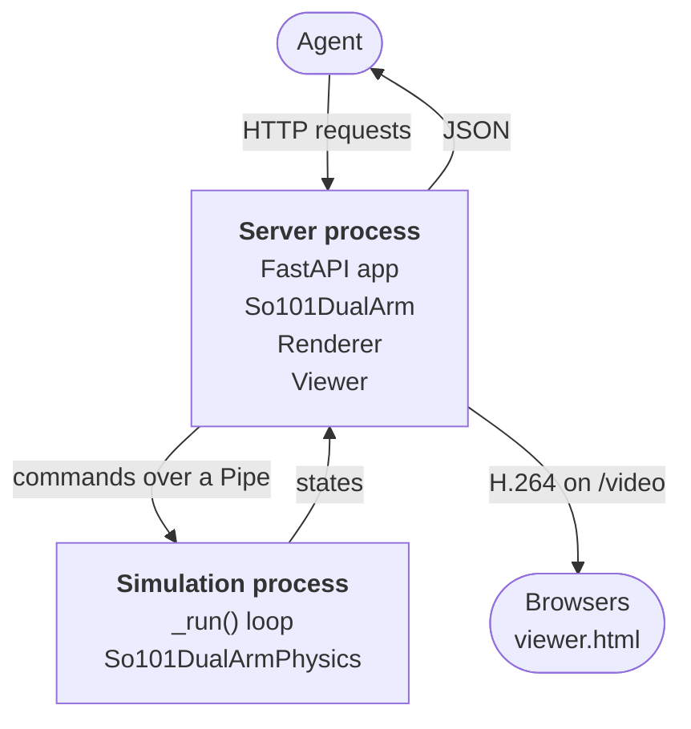

> 수집 메모: 2026-10-13 사용자의 명시적 지시로 GitHub raw URL에서 취득했다 (CLAUDE.md rule #1 자료 수집 예외). 기본 브랜치 main, 최신 커밋 54876614c00d (2026-10-12). GitHub API 기준 설명 "RoboGym - Playground for agentic robotics", 생성 2026-10-05, star 0, fork 0, 라이선스 Apache-2.0, 주 언어 Python, topics 없음, homepage 없음.
> 최상위 구성: .dockerignore, .env.example, .gitignore, LICENSE, NOTICE, README.md, pyproject.toml, robogym/, tests/, uv.lock
> robogym/ 구성: __init__.py, __main__.py, env.py, envs/ (so101_dual_arm/ 하나), physics.py, sandbox.py, server.py, viewer.html, viewer.py. tests/: conftest.py, test_envs.py, test_server.py, test_so101_dual_arm.py, test_viewer.py
> 수집 범위: 최상위 README.md 전문, robogym/envs/so101_dual_arm/README.md 전문, robogym/envs/so101_dual_arm/sandbox.toml 전문. 각 파일은 아래 `<!-- file: ... -->` 구분선 뒤에 원문 그대로 둔다. README에는 이미지가 없고 Mermaid 도식 하나만 있다.


<!-- file: README.md -->

# robogym

robogym lets AI agents control simulated robots over HTTP. The simulation runs in real time, like a real robot: it keeps going while the agent decides what to do next. You can watch it live in a browser.

## Quick start

```bash
git clone https://github.com/torayeff/robogym.git
cd robogym
uv run robogym serve so101_dual_arm --host 127.0.0.1 --port 8000
```

Open http://127.0.0.1:8000 to watch. The simulation starts paused. From another terminal, start it, move an arm and read an observation:

```bash
curl -X POST localhost:8000/resume
curl --json '{"joints": {"left_shoulder_lift": -0.75}}' localhost:8000/action
curl localhost:8000/observation
```

Interactive API documentation is at http://127.0.0.1:8000/docs.

On Linux without a display, set `MUJOCO_GL=egl` so that MuJoCo can render offscreen. On macOS, a warning at startup that `AVFFrameReceiver` is implemented twice is harmless.

## Environments

- [so101_dual_arm](robogym/envs/so101_dual_arm/README.md): two SO-101 arms at a table with a block and a tray, simulated in MuJoCo.

Each environment's README describes its robot, its observations and its actions.

## API

| Method | Path | Description |
| --- | --- | --- |
| GET | `/spec` | A description of the environment, with JSON Schemas for its observations and actions |
| GET | `/observation` | The current observation, with every reading taken at the same instant |
| POST | `/action` | Send an action, which takes effect at the next simulation step |
| POST | `/pause` | Pause the simulation |
| POST | `/resume` | Resume the simulation |
| POST | `/reset` | Reset the scene and the clock, and pause |
| GET | `/status` | Whether the simulation is running, its time, and how many steps ran late |

An action that doesn't match the spec is rejected with status 422 and a message saying what is wrong. The server has no authentication, so anyone who can reach it can control the simulation.

## Running in the cloud

robogym can serve an environment from a [Modal](https://modal.com) sandbox at a public HTTPS URL, so that agents and viewers can reach it from anywhere.

1. Create a [Modal token](https://modal.com/settings/tokens).
2. Copy [.env.example](.env.example) to `.env` and fill in the token's ID and secret.
3. Start a sandbox:

   ```bash
   uv run robogym sandbox create so101_dual_arm
   ```

The command prints the sandbox's ID and URL. `uv run robogym sandbox list` shows the running sandboxes, and `uv run robogym sandbox delete <id>` stops one. A sandbox also stops by itself after 30 minutes without connections, or after two hours.

Browsers play the video only on pages served over HTTPS or from localhost. To watch a server on another machine without a sandbox, put it behind an HTTPS proxy.

## Adding an environment

The server talks to an environment only through the `Env` interface in [robogym/env.py](robogym/env.py), whose methods match the API. That works for two kinds of simulator:

- A simulator that Python can step, such as MuJoCo, implements `Physics`, and a `PhysicsProcess` ([robogym/physics.py](robogym/physics.py)) runs it in real time.
- A simulator that runs and renders in its own process, such as Isaac Sim, can run separately, with its `Env` acting as a client to it.

To add one:

1. Create a package in `robogym/envs/` with an `Env` subclass, and register it in `ENVS` in [robogym/envs/\_\_init\_\_.py](robogym/envs/__init__.py) as `"<name>": "robogym.envs.<name>.env:<Class>"`.
2. If it uses `PhysicsProcess`, keep the `Physics` methods fast, since they run between simulation steps, and make the state it returns hold everything needed to render the scene. Keep rendering libraries out of the module that defines it, because the simulation process imports that module.
3. To run it in a cloud sandbox, add a `Dockerfile`, built from the repository root with `robogym` on its `PATH`, and a `sandbox.toml` with `vcpus`, `memory_gib` and, if it needs one, a Modal `gpu` type. A sandbox with a GPU runs under gVisor, which doesn't allow real-time priority; a sandbox without one runs in a VM, which does.
4. Run `uv run pytest`. [tests/test_envs.py](tests/test_envs.py) checks every registered environment against the `Env` interface.

[so101_dual_arm](robogym/envs/so101_dual_arm/) is a complete example.

## Architecture

An environment that uses `PhysicsProcess`, such as so101_dual_arm, runs in two processes:



### Server process

- `robogym serve <env>` ([robogym/\_\_main\_\_.py](robogym/__main__.py)) looks the environment up in `ENVS`, importing only its module, and serves `create_app()` ([robogym/server.py](robogym/server.py)) with uvicorn. `main()` imports the server inside the function, since the simulation process that `robogym` spawns imports `robogym.__main__` again and shouldn't load FastAPI, PyAV or OpenCV.
- At startup, the app's `lifespan` creates the `Env`, which starts the simulation process. Only then does it lower the server's priority by `NICE` = 10 nice levels, on Linux for each of its threads, so the simulation keeps normal priority. It then starts `Viewer.run()` and `stop_if_dead()` as asyncio tasks.
- `POST /action` turns a `ValueError` from `Env.act()` into the 422 response.
- Blocking work runs off the event loop. `PhysicsProcess` sends each command and waits for its reply on a pipe thread. so101_dual_arm's `Renderer` draws on a render thread that owns the process's only OpenGL context, since a context is current on one thread at a time. Both threads are single-thread executors. `Viewer` encodes in `asyncio.to_thread()`.

### Simulation process

- `PhysicsProcess` ([robogym/physics.py](robogym/physics.py)) runs `_run()` in a process of its own, so neither the server's work nor its GIL can hold up a step. It starts the process with `multiprocessing`'s `spawn` method, from a fresh interpreter without the server's threads or OpenGL state, and talks to it over a `multiprocessing.Pipe`.
- `_run()` ignores `SIGINT`, builds the `Physics`, raises its priority, reports that it's ready, and calls `gc.freeze()` so that garbage collections skip everything allocated during setup. For the priority, it asks for:
  - `SCHED_FIFO` at priority 1 on Linux, which needs `CAP_SYS_NICE` (`--cap-add=SYS_NICE` in Docker);
  - the Mach `THREAD_TIME_CONSTRAINT_POLICY` on macOS, with a period of one timestep, which needs no privileges.

  If the OS refuses, it logs a warning and runs at normal priority.
- `origin` is the `time.monotonic()` reading at which simulation time was 0, and the next step is due at `origin + physics.time + physics.timestep`. The loop sleeps until then and calls `physics.step(n)` with the `n` whole steps that have fallen due, normally 1, so a late wake-up catches up without moving the steps after it. If simulation time falls more than `MAX_LAG` = 0.5 s behind, the loop adds the lag to `origin` and skips the gap.
- Every step that runs more than one timestep late adds 1 to `late_steps`, `max_lateness` keeps the worst lateness, and a warning is logged at most once a second.
- Before each step, `connection.poll()` checks for a command, and a waiting command runs first: `act`, `state`, `status`, `pause`, `resume`, `reset` or `stop`. While paused, the loop waits in `connection.recv()`. `resume` resets `origin` so that simulation time carries on from where it stopped. An exception in a command is sent back as the reply, and `PhysicsProcess.call()` raises it in the server.
- If `step()` raises, the loop calls `reset()`, pauses, and adds 1 to `resets`. `So101DualArmPhysics.step()` raises `FloatingPointError` when MuJoCo sets `mjWARN_BADQPOS`, `mjWARN_BADQVEL` or `mjWARN_BADQACC`.

### Observations and actions

- `So101DualArm.observe()` sends `state`, and between two steps the loop replies with `So101DualArmPhysics.state()`: MuJoCo's `mjSTATE_INTEGRATION` state, 237 numbers. On the render thread, `Renderer` loads it into the server's own model with `mj_setState` and `mj_forward`, renders the three cameras and encodes them as JPEG while the simulation steps on. The time, joint angles and images in the reply all come from that one state.
- `So101DualArm.act()` checks the action against each servo's goal range, the one `/spec` gives, and raises `ValueError` saying what is wrong. Only a valid action is sent as `act`, so the loop never unpickles a large invalid one between two steps. `So101DualArmPhysics.act()` writes the goals into the actuators' `ctrl`.

### Video

- `GET /` serves [robogym/viewer.html](robogym/viewer.html). The page reads `GET /video` with `fetch`, decodes it with a WebCodecs `VideoDecoder` and draws each frame on a canvas. When the stream ends, it reconnects a second later.
- `Viewer.run()` ([robogym/viewer.py](robogym/viewer.py)) calls `Env.view()` every 1/30 s (`FPS`) while a browser is connected. `So101DualArm.view()` returns `None` while an observation is in progress or when the state hasn't changed since the last frame. So observations come first, and a paused simulation sends a frame only after an action or a reset.
- Each 1280 × 720 frame (`VIEW_WIDTH`, `VIEW_HEIGHT` in [robogym/env.py](robogym/env.py)) is encoded once, by libx264 through PyAV. The settings are preset `veryfast`, tune `zerolatency`, CRF 23, a keyframe every 60 frames (`KEYFRAME_INTERVAL`), and the High profile at level 3.1, which viewer.html's codec string `avc1.64001f` names. Every browser gets the same bytes: a 4-byte little-endian length, a keyframe flag byte, and the frame in H.264 Annex B format.
- A browser that connects first gets the frames since the last keyframe, so it can start decoding at once. If a browser's queue grows past 60 frames, the viewer empties it and skips to the next keyframe.

### Shutdown

- On Ctrl+C or `SIGTERM`, `Server.shutdown()` first calls `Viewer.end_streams()`, since uvicorn would otherwise wait for the `/video` responses, which never end. The lifespan then closes the `Env`: `Renderer.close()` frees the OpenGL context on the render thread, and `PhysicsProcess.close()` sends `stop` and joins the process.
- `stop_if_dead()` awaits `Env.wait()`, which polls the simulation process every 0.1 s. If the process exits, it logs the exit code and raises `SIGTERM` in the server, which shuts down as above.

### Sandboxes

- `robogym sandbox create <env>` ([robogym/sandbox.py](robogym/sandbox.py)) starts a `modal.Sandbox` in the Modal app `robogym` that runs `robogym serve <env> --host 0.0.0.0 --port 8000`. The image is built from the environment's `Dockerfile`. `cpu`, `memory` and `gpu` come from its `sandbox.toml`, with `vcpus` halved because a Modal core is two vCPUs.
- Port 8000 is published through an encrypted Modal tunnel, and `create` returns once a TCP readiness probe on it connects. Each sandbox has an `env` tag, which `robogym sandbox list` prints.

## License

Copyright 2026 [Robominder](https://robominder.ai). Licensed under the [Apache License 2.0](LICENSE). Robot models from other projects keep their own licenses, which each environment's README gives.


<!-- file: robogym/envs/so101_dual_arm/README.md -->

# so101_dual_arm

Two [SO-101](https://github.com/TheRobotStudio/SO-ARM100) robot arms stand side by side at the back of a table, with a red block and a red tray in front of them. Each object starts where only the arm beside it can reach, so getting the block into the tray takes both arms. The scene is simulated in MuJoCo, and the agent sees it through a camera on each wrist and one overhead.

## Observations and actions

Each arm has six servos: `shoulder_pan`, `shoulder_lift`, `elbow_flex`, `wrist_flex`, `wrist_roll` and `gripper`, named with a `left_` or `right_` prefix.

An observation contains the simulation time in seconds, the 12 joint angles in radians, and a 640 × 480 JPEG image, base64-encoded, from each of the three cameras: `top_camera`, `left_wrist_camera` and `right_wrist_camera`. It doesn't include the positions of the block and the tray; the agent has to find them in the images.

An action sets target angles, in radians, for any of the servos, and the servos then move the joints toward them. Servos left out of an action keep their previous targets:

```json
{"joints": {"left_shoulder_lift": -0.75, "left_gripper": 1.2}}
```

`GET /spec` lists each servo's range and which way it turns, and the sizes of the block and the tray.

## Resets

A reset folds both arms, with the grippers just above the table, and places the block beside one arm and the tray beside the other, choosing at random which goes where. Each object is turned to a random angle, and the block either stands on end or lies on its side. Three constants in `physics.py` bound where each object's centre can land:

| Constant | Bound | Purpose |
| --- | --- | --- |
| `NEAR` | Maximum distance from its own arm's shoulder-pan axis | That arm can pick up the block with its gripper tilted no more than 25° from vertical, and reach over the tray with its gripper tilted no more than 40° |
| `FAR` | Minimum distance from the other arm's shoulder-pan axis | The other arm can't grasp the block, even near one end of a lying block, or get its gripper over the tray; at full stretch, its fingertips may just touch the object |
| `FRONT` | Minimum forward position, x | The whole object stays in view of the top camera |

These reach limits come from a search over each arm's joint angles that allowed poses sinking at most 1 mm into the table, the rig or the arm itself. At the height of a block, an arm's grasp point (the `gripperframe` site) reaches at most 0.436 m from its shoulder-pan axis, and above a tray at most 0.441 m. With an object at the `FAR` bound, the other arm's grasp point comes no closer than 19 mm to the graspable part of a lying block that points at it, and 14 mm to the space over a tray turned corner-on.

## Cameras

All three cameras are modeled on the InnoMaker U20CAM-1080P-S1 module. Its wide-angle lens bends straight lines noticeably (barrel distortion), but MuJoCo can only render through an ideal pinhole. So the environment renders a wider pinhole image and warps it through a model of the lens, in `camera.py`. MuJoCo's viewer shows the cameras without the distortion.

The lens model is based on the camera's [user manual](https://github.com/INNO-MAKER/U20CAM-1080P-S1/blob/a08d78bfc7fb6b1230bad0af28192d58b557e077/U20CAM-1080P-S1%20UserManual-v1.1.pdf) (v1.1), not on a calibration. The manual gives a 2.8 mm lens on a 1/3″, 1920 × 1080 sensor with a 106° horizontal field of view. A pinhole lens of that focal length would cover only about 86°, while an equidistant fisheye lens covers 106°, so `camera.py` uses OpenCV's fisheye model with all distortion coefficients at zero. Taking the camera's 640 × 480 mode to be the 4:3 centre of the sensor, scaled down, gives a field of view of 79.5° × 59.6°.

The manual isn't fully consistent: it also gives 103° horizontal, a 130° diagonal (this model has 122°), and a −17% TV distortion without saying which convention it uses. The real vertical field of view could be anywhere from about 54° to 66°. To match a real camera, calibrate it and replace `U20CAM` in `camera.py` with the calibrated K and D.

## Viewing the scene in MuJoCo

To explore the scene without the server, open it in MuJoCo's viewer:

```bash
uv run python -m robogym.envs.so101_dual_arm
```

The viewer shows the scene as a reset leaves it. Reload (Ctrl+L) resets it, and the sliders in the Control panel move the servos.

## Files

- `env.py`: the environment the server serves, with its spec, its action checks, and the rendering of observations and video.
- `physics.py`: the simulation and the random placement on reset.
- `camera.py`: the lens model.
- `__main__.py`: the MuJoCo viewer.
- `scene.xml`: the table, the block, the tray, the lights and the folded rest pose.
- `robot/so101_dual_arm.xml`: the mounting rig and the overhead camera, with both arms attached.
- `robot/so101.xml`: one arm with its wrist camera.
- `robot/u20cam.xml`: the camera module.
- `robot/assets/`: the 21 STL meshes.
- `Dockerfile`, `sandbox.toml`: the image and resources for a Modal sandbox.

`physics.py` builds two models from `scene.xml` in memory, leaving the mesh files unchanged. The simulation process gets a model without the meshes that are only drawn, 7 MB in size. The renderer gets the full scene, in which the two arms and three cameras share one copy of each mesh: 65 MB instead of the 125 MB MuJoCo would load by default.

The Modal sandbox has a T4 GPU, since rendering on the sandbox's CPUs is about ten times slower and takes CPU time from the simulation. A sandbox with a GPU can't give the simulation real-time priority, but with the rendering on the GPU, the simulation still runs on time.

## Sources and license

The arm is The Robot Studio's open-source [SO-101](https://github.com/TheRobotStudio/SO-ARM100). `robot/so101.xml` is adapted from [MuJoCo Menagerie's `robotstudio_so101`](https://github.com/google-deepmind/mujoco_menagerie/tree/822c2d8f877dd166c5b7d3c9f7e3c3b6589473b7/robotstudio_so101) at revision `822c2d8`, which Menagerie derived from The Robot Studio's [SO101 MJCF](https://github.com/TheRobotStudio/SO-ARM100/blob/608122e9ac330a753735f2e18aee73338e9ac407/Simulation/SO101/so101_new_calib.xml). Both are licensed under Apache-2.0, and [robot/LICENSE](robot/LICENSE) is a copy of that license.

Compared with Menagerie, the body frames, the joint limits, damping, friction loss and armature, the actuator gains and force range, the collision geometry from the upper arm to the gripper, and every link inertia except the gripper's are unchanged. The changes are:

- Printed parts are white instead of yellow.
- The fixed jaw is drawn with the SO-ARM100 wrist camera mount, replacing Menagerie's fixed-jaw and camera-mount meshes. It holds a 10 g U20CAM camera (`robot/u20cam.xml`) with box collision envelopes.
- The gripper link is 0.0939 kg (Menagerie: 0.087 kg), with its own inertia, to suit this mount.
- The `wrist_roll` control range is ±2.74385 rad, matching its joint range (Menagerie: −2.74385 to 2.84121, past the joint limit).
- The base and shoulder have collision boxes fitted to their meshes. Menagerie has none on the base, and its two shoulder boxes leave up to 14 mm of the bracket and servo uncovered. The base is welded to the world, which MuJoCo's parent-child filter skips, so a `<contact><exclude>` keeps the base and shoulder boxes apart.
- Gripper contacts use `solref="0.006 1"` and `solimp="0.95 0.99 0.001"` (Menagerie: `0.01 1`, the stiffest its 5 ms timestep allows, and the default `solimp`). The gripper geoms have contact priority, so these values apply to every grasp: at full grip the fingertips sink about 1 mm into the block instead of 2.5 mm.
- Menagerie's `<option>`, `<visual>`, comments, and unused defaults and meshes are dropped; `scene.xml` sets the simulation and visual options.

`robot/so101_dual_arm.xml` (the rig: part placement, collision boxes and the overhead camera), `robot/u20cam.xml` and `scene.xml` were written for this project. The block and the tray are boxes of uniform density.

| Meshes in `robot/assets/` | Source | Changes |
| --- | --- | --- |
| Printed parts: `base_so101_v2`, `base_motor_holder_so101_v1`, `waveshare_mounting_plate_so101_v2`, `motor_holder_so101_base_v1`, `rotation_pitch_so101_v1`, `upper_arm_so101_v1`, `under_arm_so101_v1`, `motor_holder_so101_wrist_v1`, `wrist_roll_pitch_so101_v2`, `moving_jaw_so101_v1`<br>Servos: `sts3215_03a_v1`, `sts3215_03a_no_horn_v1`<br>Gripper collision meshes: `wrist_roll_follower_so101_gripper_part0_v1`, `moving_jaw_so101_gripper_part0_v1`, `moving_jaw_so101_gripper_part1_v1` | [Menagerie `robotstudio_so101/assets`](https://github.com/google-deepmind/mujoco_menagerie/tree/822c2d8f877dd166c5b7d3c9f7e3c3b6589473b7/robotstudio_so101/assets), revision `822c2d8` | none |
| `arm_base`, `cam_mount_bottom`, `cam_mount_middle`, `cam_mount_top` | SO-ARM100 [overhead camera mount](https://github.com/TheRobotStudio/SO-ARM100/tree/7629d2ad9853d10fb903093a33ef6114099d97e5/Optional/Overhead_Cam_Mount_32x32_UVC_Module/stl), revision `7629d2a` | none |
| `wrist_cam_mount_32x32_uvc_module_so101` | SO-ARM100 [wrist camera mount](https://github.com/TheRobotStudio/SO-ARM100/blob/7629d2ad9853d10fb903093a33ef6114099d97e5/Optional/Wrist_Cam_Mount_32x32_UVC_Module/stl/Wrist_Cam_Mount_32x32_UVC_Module_SO101.stl), revision `7629d2a` | converted from ASCII to binary STL; 1,915 duplicate triangles removed |
| `u20cam_1080p` | Modeled for this project from the dimensions and photos of the [InnoMaker U20CAM-1080P](https://github.com/INNO-MAKER/U20CAM-1080P-S1) | — |


<!-- file: robogym/envs/so101_dual_arm/sandbox.toml -->

```toml
vcpus = 4
memory_gib = 8
gpu = "T4"
```
