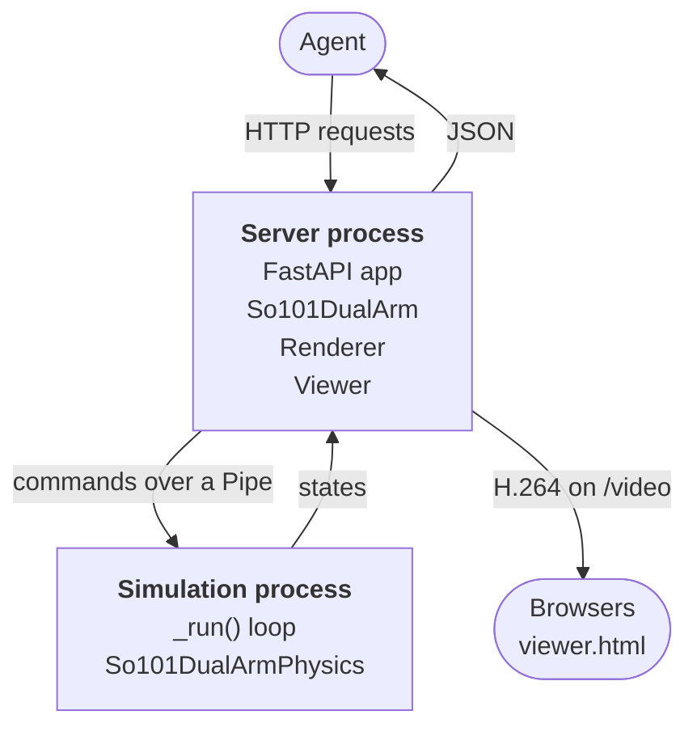

## 요약

robogym은 AI 에이전트가 HTTP 요청만으로 시뮬레이션 로봇을 제어하게 하는 Python 서버다. 저장소 설명은 "Playground for agentic robotics"이고, 저작권자는 Robominder, 라이선스는 Apache-2.0이다. 수집 시점(2026-10-12 커밋)에는 공개된 지 일주일 남짓 된 초기 저장소로 star와 fork가 모두 0이다.

이 저장소의 핵심 설계는 시뮬레이션이 실제 로봇처럼 **실시간**으로 계속 진행된다는 점이다. 에이전트가 다음 action을 고민하는 동안에도 시뮬레이션 시계는 멈추지 않는다. 따라서 에이전트의 추론 지연이 그대로 제어 결과에 영향을 주며, 그 장면은 브라우저에서 H.264 영상으로 실시간 시청할 수 있다.

현재 제공되는 환경은 so101_dual_arm 하나다. MuJoCo로 시뮬레이션한 SO-101 팔 두 대가 테이블에 놓인 블록을 트레이로 옮기는 장면이며, 물체 배치가 한 팔만으로는 과제를 끝낼 수 없도록 설계되어 있다. README는 이 환경의 물리 모델, 카메라 렌즈, 물체 배치 제약을 수치까지 상세히 기록한다.

## 배경

강화학습 연구에서 흔히 쓰는 gym 계열 환경은 동기식이다. 에이전트가 `step(action)`을 호출해야 시뮬레이션이 한 timestep 진행되고, 에이전트가 생각하는 동안 세계는 멈춰 있다. 이 방식은 학습에는 편리하지만, 실제 로봇이 처한 조건과는 다르다. 실제 로봇 앞에서 세계는 에이전트를 기다려 주지 않는다.

LLM이나 VLM 기반 에이전트가 로봇을 다룰 때 이 차이는 더 커진다. 이런 에이전트는 한 번의 판단에 수백 ms에서 수 초가 걸리고, 그동안 팔은 이전 목표를 향해 계속 움직인다. robogym은 이 조건을 시뮬레이션 안에서 그대로 재현하는 것을 목표로 삼는다. README는 이를 "like a real robot: it keeps going while the agent decides what to do next"라고 표현한다.

두 번째 출발점은 인터페이스다. Python 객체로 환경을 import해야 하는 gym API와 달리, robogym은 환경을 HTTP 서버로 노출한다. 따라서 에이전트는 어떤 언어로 작성되든, 어느 기기에서 실행되든 `curl`로 호출할 수 있는 몇 개의 엔드포인트만 알면 된다. 이 구조는 tool call로 외부 API를 호출하는 LLM 에이전트와 자연스럽게 맞물린다. tool call은 모델이 도구 하나를 실제로 호출하는 한 번의 실행 단위다.

## 핵심 개념

observation은 매 시점에 에이전트가 받는 센서 입력이다. robogym에서는 `GET /observation` 응답이 observation이며, 시뮬레이션 시간, 관절 각도, 카메라 이미지를 담는다. README는 모든 값이 **같은 순간**에 측정된다는 점을 강조한다. 이미지와 관절 각도가 서로 다른 시점에서 오면 에이전트가 장면을 잘못 해석할 수 있기 때문이다.

action은 에이전트가 출력하는 제어 명령이다. robogym의 action은 서보의 목표 각도(rad)이며, 서보는 그 목표를 향해 관절을 움직인다. 즉 action은 관절을 즉시 특정 위치로 옮기는 명령이 아니라 position controller에 주는 목표값이다. action에 포함하지 않은 서보는 이전 목표를 유지한다.

timestep은 물리 시뮬레이션이 한 번에 진행하는 시간 간격이다. robogym은 이 timestep을 실제 시계에 맞춰 실행하려 한다. 시뮬레이션이 정해진 시각보다 한 timestep 넘게 늦게 실행되면 그 step을 "late step"으로 집계하고, `/status`로 보고한다.

시뮬레이터는 물리 엔진으로 로봇과 환경의 상호작용을 계산해 실제 기기 없이 데이터를 만들고 policy를 평가하는 소프트웨어다. robogym은 그 자체로 시뮬레이터가 아니라 시뮬레이터를 감싸는 서버이고, so101_dual_arm에서는 MuJoCo가 시뮬레이터 역할을 한다. 서버와 시뮬레이터 사이의 계약은 `Env` 인터페이스 하나로 정해진다.

## 사용 방법

### 빠른 시작

설치는 저장소를 clone한 뒤 `uv`로 서버를 띄우는 것으로 끝난다.

```bash
git clone https://github.com/torayeff/robogym.git
cd robogym
uv run robogym serve so101_dual_arm --host 127.0.0.1 --port 8000
```

브라우저에서 http://127.0.0.1:8000 을 열면 장면이 보인다. 시뮬레이션은 일시정지 상태로 시작하므로, 다른 터미널에서 재개한 뒤 팔을 움직이고 observation을 읽는다.

```bash
curl -X POST localhost:8000/resume
curl --json '{"joints": {"left_shoulder_lift": -0.75}}' localhost:8000/action
curl localhost:8000/observation
```

FastAPI가 생성하는 대화형 API 문서는 `/docs`에 있다. 운영체제별 주의 사항은 두 가지다.

- 디스플레이가 없는 Linux에서는 `MUJOCO_GL=egl`을 설정해 MuJoCo가 오프스크린으로 렌더링하게 한다.
- macOS에서 시작 시 `AVFFrameReceiver`가 두 번 구현되어 있다는 경고가 나오지만 무해하다.

### HTTP API

에이전트가 쓰는 인터페이스는 일곱 개 엔드포인트가 전부다.

| 메서드 | 경로 | 설명 |
|---|---|---|
| GET | `/spec` | 환경 설명, observation과 action의 JSON Schema |
| GET | `/observation` | 현재 observation (모든 값이 같은 순간에 측정됨) |
| POST | `/action` | action 전송, 다음 시뮬레이션 step에 적용 |
| POST | `/pause` | 시뮬레이션 일시정지 |
| POST | `/resume` | 시뮬레이션 재개 |
| POST | `/reset` | 장면과 시계를 초기화하고 일시정지 |
| GET | `/status` | 실행 여부, 시뮬레이션 시간, 늦게 실행된 step 수 |

`/spec`은 에이전트가 처음 호출할 엔드포인트다. observation과 action의 형식을 JSON Schema로 제공하므로, LLM 에이전트는 이 스키마를 읽고 유효한 요청을 구성할 수 있다. 스키마에 맞지 않는 action은 상태 코드 422와 함께 무엇이 틀렸는지 설명하는 메시지로 거부된다.

일시정지와 재개는 실시간 진행이라는 기본 설정에서 벗어나는 수단이다. 에이전트가 긴 판단을 해야 하는 실험에서는 `/pause`로 세계를 멈출 수 있다. 반면 `/reset`은 장면을 초기화한 뒤 항상 일시정지 상태로 남기므로, 에이전트가 준비를 마친 뒤 `/resume`으로 다음 episode를 시작한다. episode는 과제 시작부터 종료까지의 한 실행 단위다.

서버에는 인증 기능이 없다. 서버 주소에 접근할 수 있는 누구나 시뮬레이션을 제어할 수 있으므로, 공개 네트워크에 노출할 때는 이 점을 고려해야 한다.

### 클라우드 샌드박스

robogym은 Modal 샌드박스에서 환경을 공개 HTTPS URL로 띄울 수 있다. 샌드박스는 에이전트가 실행하는 코드와 명령을 호스트와 격리된 환경 안에 가두는 실행 공간이다. 여기서는 에이전트와 시청자가 어디서든 접속할 수 있는 원격 실행 환경으로 쓰인다. 절차는 세 단계다.

1. Modal 토큰을 만든다.
2. `.env.example`을 `.env`로 복사하고 토큰 ID와 secret을 채운다.
3. `uv run robogym sandbox create so101_dual_arm`으로 샌드박스를 시작한다.

명령은 샌드박스 ID와 URL을 출력한다. `uv run robogym sandbox list`가 실행 중인 샌드박스를 보여주고, `uv run robogym sandbox delete <id>`가 하나를 멈춘다. 샌드박스는 연결 없이 30분이 지나거나 시작 후 2시간이 지나면 스스로 종료된다.

샌드박스 없이 다른 기기의 서버를 보려면 HTTPS 프록시를 앞에 둔다. 브라우저가 영상을 HTTPS 페이지나 localhost 페이지에서만 재생하기 때문이다.

## 아키텍처

### 2-프로세스 구조

`PhysicsProcess`를 쓰는 환경은 서버 프로세스와 시뮬레이션 프로세스, 두 프로세스로 실행된다. README의 Mermaid 도식을 그대로 옮기면 다음과 같다.



에이전트와 브라우저는 서버 프로세스와만 통신한다. 서버 프로세스는 `multiprocessing.Pipe`로 시뮬레이션 프로세스에 명령을 보내고 상태를 받는다.

| 프로세스 | 구성 요소 | 역할 |
|---|---|---|
| 서버 프로세스 | FastAPI 앱, `So101DualArm`(Env), `Renderer`, `Viewer` | HTTP 처리, 렌더링, 영상 인코딩 |
| 시뮬레이션 프로세스 | `_run()` 루프, `So101DualArmPhysics` | 물리 step 실행, 명령 처리 |

프로세스를 나누는 이유는 실시간성이다. 렌더링, JPEG 인코딩, H.264 인코딩, HTTP 처리는 모두 무거운 작업이다. 이 작업이 시뮬레이션과 같은 프로세스에 있으면 Python의 GIL을 두고 경쟁해 step이 밀린다. 따라서 robogym은 무거운 작업을 서버 프로세스로 몰고, 시뮬레이션 프로세스에는 물리 계산만 남긴다.

### 서버 프로세스

서버 프로세스는 시작 순서와 스레드 배치를 세심하게 관리한다.

- `robogym serve <env>`는 `ENVS` 레지스트리에서 환경을 찾아 그 모듈만 import하고, uvicorn으로 `create_app()`을 서빙한다.
- `main()`은 서버 모듈을 함수 안에서 import한다. 시뮬레이션 프로세스가 `spawn`으로 시작될 때 `robogym.__main__`을 다시 import하는데, 이때 FastAPI, PyAV, OpenCV를 불러오지 않게 하기 위해서다.
- 앱의 `lifespan`이 Env를 생성하면 시뮬레이션 프로세스가 시작된다. 그다음에야 서버는 자기 우선순위를 `NICE` = 10 단계 낮춘다 (Linux에서는 스레드마다). 시뮬레이션 프로세스가 정상 우선순위를 유지하게 하려는 순서다.
- 이후 `Viewer.run()`과 `stop_if_dead()`를 asyncio 태스크로 시작한다.
- `POST /action`은 `Env.act()`가 낸 `ValueError`를 422 응답으로 변환한다.

블로킹 작업은 모두 이벤트 루프 밖에서 실행된다. `PhysicsProcess`는 명령을 보낸 뒤 파이프 스레드에서 응답을 기다린다. `Renderer`는 프로세스의 유일한 OpenGL 컨텍스트를 소유한 렌더 스레드에서 그린다. OpenGL 컨텍스트는 한 번에 한 스레드에서만 current 상태가 될 수 있기 때문이다. 두 스레드는 모두 단일 스레드 executor이고, `Viewer`의 인코딩은 `asyncio.to_thread()`에서 실행된다.

### 시뮬레이션 프로세스

시뮬레이션 프로세스는 "정해진 시각에 정해진 step을 실행한다"는 목표 하나를 위해 설계되었다.

**프로세스 시작.** `PhysicsProcess`는 `multiprocessing`의 `spawn` 방식으로 새 인터프리터를 띄운다. 따라서 서버의 스레드나 OpenGL 상태를 물려받지 않는다. `_run()`은 다음 순서로 준비한다.

1. `SIGINT`를 무시한다 (종료는 서버가 `stop` 명령으로 지시한다).
2. `Physics` 객체를 만든다.
3. 스케줄링 우선순위를 올린다.
4. 준비 완료를 서버에 알린다.
5. `gc.freeze()`를 호출해 설정 단계에서 할당한 객체를 가비지 컬렉션 대상에서 뺀다. 이후 가비지 컬렉션이 step 사이에 오래 멈추는 것을 줄이기 위한 조치다.

**우선순위 요청.** 운영체제마다 다른 실시간 스케줄링을 요청한다.

| OS | 요청 | 필요 권한 |
|---|---|---|
| Linux | `SCHED_FIFO` 우선순위 1 | `CAP_SYS_NICE` (Docker에서는 `--cap-add=SYS_NICE`) |
| macOS | Mach `THREAD_TIME_CONSTRAINT_POLICY`, 주기 = 한 timestep | 없음 |

OS가 요청을 거부하면 경고를 남기고 일반 우선순위로 계속 실행한다. 즉 실시간 우선순위는 필수가 아니라 최선 노력이다.

**시간 맞추기.** `origin`은 시뮬레이션 시간이 0이었던 순간의 `time.monotonic()` 값이다. 다음 step의 기한은 `origin + physics.time + physics.timestep`으로 계산된다. 루프는 그 시각까지 잠든 뒤, 기한이 지난 정수 개의 step `n`을 `physics.step(n)`으로 한꺼번에 실행한다. 보통 `n`은 1이다.

이 방식의 장점은 늦게 깨어나도 이후 일정이 밀리지 않는다는 데 있다. 예를 들어 OS 스케줄러 때문에 루프가 2 timestep 늦게 깨어나면, 그 자리에서 밀린 step을 함께 실행하고 원래 일정을 회복한다. 매번 "지금부터 한 timestep 뒤"로 다음 기한을 잡는 방식이었다면 지연이 누적되었을 것이다.

다만 따라잡기에도 한계가 있다. 시뮬레이션 시간이 `MAX_LAG` = 0.5초 넘게 뒤처지면, 루프는 그 지연분을 `origin`에 더해 해당 구간을 건너뛴다. 큰 지연 뒤에 수백 step을 몰아서 실행하면 시뮬레이션이 실제 시계보다 빨리 흐르는 구간이 생기기 때문이다.

**지연 계측.** 한 timestep 넘게 늦게 실행된 step마다 `late_steps`가 1 늘고, `max_lateness`가 최악의 지연을 기록한다. 지연 경고는 초당 최대 한 번만 로그에 남긴다. `/status`가 이 값을 노출하므로 에이전트 실험자는 실시간성이 지켜졌는지 확인할 수 있다.

**명령 처리.** 각 step 전에 루프는 `connection.poll()`로 대기 중인 명령이 있는지 확인하고, 있으면 먼저 실행한다. 명령 종류는 일곱 가지다.

| 명령 | 동작 |
|---|---|
| `act` | 서보 목표값을 actuator `ctrl`에 기록 |
| `state` | 현재 시뮬레이션 상태 반환 |
| `status` | 실행 여부, 시간, 지연 통계 반환 |
| `pause` | 일시정지 (이후 `connection.recv()`에서 대기) |
| `resume` | `origin`을 다시 잡아 멈춘 시점부터 이어서 진행 |
| `reset` | 장면 초기화 |
| `stop` | 루프 종료 |

명령 실행 중 예외가 나면 그 예외 자체가 응답으로 전송되고, 서버의 `PhysicsProcess.call()`이 그것을 다시 발생시킨다. 즉 시뮬레이션 프로세스의 오류가 서버 쪽 호출 지점에서 그대로 드러난다.

**수치 폭주 복구.** `step()`이 예외를 내면 루프는 `reset()`을 호출하고 일시정지하며 `resets` 카운터를 1 늘린다. `So101DualArmPhysics.step()`은 MuJoCo가 `mjWARN_BADQPOS`, `mjWARN_BADQVEL`, `mjWARN_BADQACC` 중 하나를 설정하면 `FloatingPointError`를 낸다. 이 경고는 관절 위치, 속도, 가속도가 비정상 값이 되었다는 뜻이다. 따라서 에이전트가 무리한 action으로 시뮬레이션을 폭주시키면 장면이 자동으로 초기화된다.

### observation과 action 처리 경로

observation 경로는 시뮬레이션을 멈추지 않으면서 일관된 스냅숏을 얻도록 설계되었다.

1. `So101DualArm.observe()`가 `state` 명령을 보낸다.
2. 시뮬레이션 루프는 두 step 사이에 `So101DualArmPhysics.state()`로 답한다. 이 값은 MuJoCo의 `mjSTATE_INTEGRATION` 상태로, 숫자 237개다.
3. 서버의 `Renderer`가 렌더 스레드에서 이 상태를 서버 자신의 모델에 `mj_setState`와 `mj_forward`로 적재한다.
4. 카메라 세 대를 렌더링하고 JPEG로 인코딩한다. 그동안 시뮬레이션은 계속 진행된다.

응답에 담긴 시간, 관절 각도, 이미지는 모두 이 한 상태에서 나온다. 따라서 "모든 값이 같은 순간에 측정된다"는 API 약속이 지켜진다. 렌더링이 시뮬레이션 프로세스 밖에서 일어나므로, 무거운 렌더링이 step 일정을 방해하지도 않는다.

action 경로는 검증을 서버에서 끝낸다. `So101DualArm.act()`는 `/spec`이 제시하는 서보별 목표 범위로 action을 검사하고, 범위를 벗어나면 무엇이 틀렸는지 담은 `ValueError`를 낸다. 유효한 action만 `act` 명령으로 시뮬레이션 프로세스에 전달된다. 그 결과 시뮬레이션 루프가 두 step 사이에서 크고 무효한 action을 unpickle하느라 시간을 쓰는 일이 없다. `So101DualArmPhysics.act()`는 받은 목표값을 actuator의 `ctrl`에 쓴다.

### 영상 스트리밍

브라우저 시청 경로는 저지연과 다중 시청자를 함께 고려한다.

- `GET /`는 `viewer.html`을 서빙한다. 페이지는 `GET /video`를 `fetch`로 읽고, WebCodecs `VideoDecoder`로 디코딩해 canvas에 그린다. 스트림이 끊기면 1초 뒤 다시 연결한다.
- `Viewer.run()`은 브라우저가 연결된 동안 1/30초(`FPS`)마다 `Env.view()`를 호출한다.
- `So101DualArm.view()`는 observation이 처리 중이거나 직전 프레임 이후 상태가 바뀌지 않았으면 `None`을 반환한다. 따라서 렌더 스레드에서 observation이 영상보다 우선하고, 일시정지된 시뮬레이션은 action이나 reset이 있을 때만 새 프레임을 보낸다.

인코딩 설정은 다음과 같다.

| 항목 | 값 |
|---|---|
| 해상도 | 1280 × 720 (`VIEW_WIDTH`, `VIEW_HEIGHT`) |
| 인코더 | libx264 (PyAV 경유) |
| preset / tune | `veryfast` / `zerolatency` |
| 화질 | CRF 23 |
| keyframe 간격 | 60프레임 (`KEYFRAME_INTERVAL`) |
| profile | High, level 3.1 (코덱 문자열 `avc1.64001f`) |

각 프레임은 한 번만 인코딩되고 모든 브라우저가 같은 바이트를 받는다. 전송 형식은 4바이트 little-endian 길이, keyframe 플래그 1바이트, H.264 Annex B 형식 프레임 순서다. 브라우저 수가 늘어도 인코딩 비용이 늘지 않는 구조다.

새로 연결한 브라우저는 마지막 keyframe 이후의 프레임을 먼저 받아 곧바로 디코딩을 시작한다. 반대로 느린 브라우저의 큐가 60프레임을 넘으면 뷰어가 큐를 비우고 다음 keyframe으로 건너뛴다. 즉 느린 시청자는 프레임을 잃지만 지연이 쌓이지는 않는다.

### 종료 처리

종료 경로는 끝나지 않는 영상 스트림과 시뮬레이션 프로세스의 비정상 종료를 모두 다룬다.

- Ctrl+C나 `SIGTERM`을 받으면 `Server.shutdown()`이 먼저 `Viewer.end_streams()`를 호출한다. `/video` 응답은 스스로 끝나지 않으므로, 이 단계가 없으면 uvicorn이 영원히 기다린다.
- 이어서 lifespan이 Env를 닫는다. `Renderer.close()`가 렌더 스레드에서 OpenGL 컨텍스트를 해제하고, `PhysicsProcess.close()`가 `stop`을 보낸 뒤 프로세스를 join한다.
- `stop_if_dead()`는 0.1초마다 시뮬레이션 프로세스를 확인하는 `Env.wait()`를 기다린다. 시뮬레이션 프로세스가 죽으면 종료 코드를 기록하고 서버 자신에게 `SIGTERM`을 보내, 위와 같은 순서로 종료한다.

### 샌드박스 내부

`robogym sandbox create <env>`는 Modal 앱 `robogym` 안에 `modal.Sandbox`를 띄우고, 그 안에서 `robogym serve <env> --host 0.0.0.0 --port 8000`을 실행한다.

- 이미지는 환경 폴더의 `Dockerfile`로 빌드한다.
- `cpu`, `memory`, `gpu`는 환경의 `sandbox.toml`에서 읽는다. Modal 코어 하나가 vCPU 두 개이므로 `vcpus` 값을 절반으로 나눠 넘긴다.
- 포트 8000은 암호화된 Modal 터널로 공개된다. `create`는 이 포트에 대한 TCP 준비 확인이 연결된 뒤에 반환한다.
- 샌드박스마다 `env` 태그가 붙고, `sandbox list`가 이 태그를 출력한다.

## 환경 추가

서버는 `robogym/env.py`의 `Env` 인터페이스로만 환경과 통신하고, 그 메서드는 HTTP API와 일대일로 대응한다. 이 인터페이스는 두 종류의 시뮬레이터를 수용한다.

| 시뮬레이터 유형 | 예 | 연결 방식 |
|---|---|---|
| Python에서 step 가능 | MuJoCo | `Physics`를 구현하고 `PhysicsProcess`가 실시간으로 실행 |
| 자기 프로세스에서 실행과 렌더링 | Isaac Sim | 시뮬레이터를 별도로 실행하고 `Env`가 그 클라이언트로 동작 |

새 환경을 추가하는 절차는 네 단계다.

1. `robogym/envs/` 아래에 `Env` 하위 클래스를 담은 패키지를 만들고, `robogym/envs/__init__.py`의 `ENVS`에 `"<name>": "robogym.envs.<name>.env:<Class>"` 형식으로 등록한다.
2. `PhysicsProcess`를 쓴다면 `Physics` 메서드를 빠르게 유지한다. 이 메서드는 시뮬레이션 step 사이에서 실행되므로 느리면 실시간성이 깨진다. 반환하는 상태에는 장면 렌더링에 필요한 모든 정보를 담는다. 또한 `Physics`를 정의한 모듈에는 렌더링 라이브러리를 두지 않는다. 시뮬레이션 프로세스가 그 모듈을 import하기 때문이다.
3. 클라우드 샌드박스에서 실행하려면 `Dockerfile`(저장소 루트에서 빌드, `PATH`에 `robogym` 포함)과 `sandbox.toml`(`vcpus`, `memory_gib`, 필요 시 Modal `gpu` 타입)을 추가한다.
4. `uv run pytest`를 실행한다. `tests/test_envs.py`가 등록된 모든 환경을 `Env` 인터페이스 기준으로 검사한다.

3단계에는 실시간성과 관련된 제약이 하나 있다. GPU가 있는 샌드박스는 gVisor 위에서 실행되어 실시간 우선순위를 허용하지 않고, GPU가 없는 샌드박스는 VM에서 실행되어 허용한다. 따라서 렌더링 성능과 스케줄링 보장 사이에서 선택이 필요하다.

## so101_dual_arm 환경

### 장면과 과제

SO-101 팔 두 대가 테이블 뒤편에 나란히 서 있고, 그 앞에 빨간 블록과 빨간 트레이가 놓여 있다. 각 물체는 바로 옆 팔만 닿을 수 있는 곳에서 시작한다. 따라서 블록을 트레이에 넣으려면 한 팔이 블록을 집어 중간으로 옮기고 다른 팔이 이어받는 식으로 두 팔이 협업해야 한다. 에이전트는 양 손목 카메라와 머리 위 카메라 한 대로 장면을 본다.

README는 과제 목표를 장면 설명으로만 제시한다. 성공 판정 기준이나 reward는 API에 없으며, 판정은 사용하는 쪽에 맡겨져 있다.

### observation과 action

| 구분 | 내용 |
|---|---|
| 서보 | 팔마다 `shoulder_pan`, `shoulder_lift`, `elbow_flex`, `wrist_flex`, `wrist_roll`, `gripper` 6개, `left_` 또는 `right_` 접두사 (총 12개) |
| observation | 시뮬레이션 시간(초), 관절 각도 12개(rad), 카메라 3대의 640 × 480 JPEG 이미지 (base64) |
| 카메라 | `top_camera`, `left_wrist_camera`, `right_wrist_camera` |
| observation에 없는 것 | 블록과 트레이의 위치 |
| action | 일부 서보의 목표 각도(rad), 빠진 서보는 이전 목표 유지 |
| `/spec` 추가 정보 | 서보별 범위와 회전 방향, 블록과 트레이의 크기 |

action은 다음과 같은 JSON이다. 이 예시는 왼팔의 shoulder lift와 그리퍼만 바꾸고 나머지 10개 서보는 그대로 둔다. 그리퍼는 물체를 집는 end-effector의 한 형태다.

```json
{"joints": {"left_shoulder_lift": -0.75, "left_gripper": 1.2}}
```

observation에 물체 위치가 없다는 점이 이 환경의 성격을 정한다. 에이전트는 카메라 이미지에서 블록과 트레이를 직접 찾아야 하므로, 이 환경은 시각 인식과 관절 제어를 함께 요구한다. 즉 VLM 기반 에이전트를 시험하기에 맞는 구성이다.

### reset과 물체 배치

reset은 두 팔을 접고 그리퍼를 테이블 바로 위에 둔다. 그리고 블록과 트레이를 각각 한쪽 팔 옆에 놓는데, 어느 쪽에 무엇을 둘지는 무작위로 정한다. 각 물체는 무작위 각도로 회전하고, 블록은 세워지거나 눕혀진다.

물체 중심이 놓일 수 있는 범위는 `physics.py`의 세 상수가 정한다.

| 상수 | 경계 | 목적 |
|---|---|---|
| `NEAR` | 자기 팔 shoulder-pan 축에서의 최대 거리 | 그 팔이 그리퍼를 수직에서 25° 이내로 기울여 블록을 집고, 40° 이내로 기울여 트레이 위에 닿을 수 있음 |
| `FAR` | 반대 팔 shoulder-pan 축에서의 최소 거리 | 반대 팔은 블록을 잡거나 트레이 위로 그리퍼를 가져갈 수 없음. 완전히 뻗으면 손끝이 물체에 살짝 닿을 수는 있음 |
| `FRONT` | 최소 전방 위치 x | 물체 전체가 머리 위 카메라 시야 안에 들어옴 |

이 경계값은 어림값이 아니라 탐색 결과다. 각 팔의 관절 각도를 탐색하면서 테이블, 리그, 팔 자신에 최대 1 mm까지만 파고드는 자세를 허용했다. 그 결과 도달 한계는 다음과 같다.

| 측정 | 값 |
|---|---|
| 블록 높이에서 grasp point(`gripperframe` site)의 최대 도달 거리 | shoulder-pan 축에서 0.436 m |
| 트레이 위에서 grasp point의 최대 도달 거리 | 0.441 m |
| `FAR` 경계에서 반대 팔 grasp point와 누운 블록의 잡을 수 있는 부분 사이 최소 간격 | 19 mm |
| `FAR` 경계에서 반대 팔 grasp point와 모서리를 향한 트레이 위 공간 사이 최소 간격 | 14 mm |

이 수치는 `FAR` 조건이 실제로 성립한다는 근거다. 반대 팔이 가장 유리한 자세를 취해도 블록의 잡을 수 있는 부분까지 19 mm가 남으므로, 한 팔만으로 과제를 끝내는 지름길이 없다.

### 카메라 렌즈 모델

세 카메라는 모두 InnoMaker U20CAM-1080P-S1 모듈을 모델로 한다. 이 모듈의 광각 렌즈는 직선을 눈에 띄게 휘게 하는 barrel distortion을 만든다. 그러나 MuJoCo는 이상적인 핀홀 카메라로만 렌더링할 수 있다. 그래서 환경은 더 넓은 핀홀 이미지를 먼저 렌더링한 뒤, `camera.py`의 렌즈 모델로 이미지를 왜곡한다. MuJoCo 뷰어는 이 왜곡 없이 카메라 시야를 보여준다.

렌즈 모델의 근거는 실측 보정이 아니라 카메라 사용자 매뉴얼 v1.1이다. 추론 과정은 다음과 같다.

1. 매뉴얼은 1/3″, 1920 × 1080 센서에 2.8 mm 렌즈, 수평 화각 106°를 제시한다.
2. 그 초점 거리의 핀홀 렌즈라면 약 86°만 담는다. 반면 equidistant fisheye 렌즈는 106°를 담는다.
3. 따라서 `camera.py`는 왜곡 계수를 모두 0으로 둔 OpenCV fisheye 모델을 쓴다.
4. 카메라의 640 × 480 모드를 센서 중앙 4:3 영역을 축소한 것으로 보면 화각은 79.5° × 59.6°가 된다.

README는 매뉴얼 자체가 일관되지 않다는 점도 밝힌다. 매뉴얼에는 수평 103°, 대각 130°(이 모델은 122°), 규약을 밝히지 않은 TV distortion −17%가 함께 적혀 있다. 이 불확실성 때문에 실제 수직 화각은 약 54°에서 66° 사이 어디든 될 수 있다. 실제 카메라와 맞추려면 카메라를 보정한 뒤 `camera.py`의 `U20CAM`을 보정된 K와 D 행렬로 바꾸라고 안내한다. 이 안내는 시뮬레이션 이미지를 실제 카메라 이미지와 맞추는 sim2real 준비 단계로 볼 수 있다. sim2real은 시뮬레이션에서 학습한 policy를 실제 기기로 옮기는 문제다.

### MuJoCo 뷰어

서버 없이 장면만 탐색하려면 MuJoCo 뷰어를 연다.

```bash
uv run python -m robogym.envs.so101_dual_arm
```

뷰어는 reset 직후의 장면을 보여준다. Ctrl+L(Reload)로 다시 reset하고, Control 패널의 슬라이더로 서보를 움직인다.

### 파일 구성

| 파일 | 내용 |
|---|---|
| `env.py` | 서버가 서빙하는 환경 (스펙, action 검사, observation과 영상 렌더링) |
| `physics.py` | 시뮬레이션과 reset 시 무작위 배치 |
| `camera.py` | 렌즈 모델 |
| `__main__.py` | MuJoCo 뷰어 |
| `scene.xml` | 테이블, 블록, 트레이, 조명, 접힌 초기 자세 |
| `robot/so101_dual_arm.xml` | 장착 리그와 머리 위 카메라, 양팔 부착 |
| `robot/so101.xml` | 손목 카메라가 달린 팔 하나 |
| `robot/u20cam.xml` | 카메라 모듈 |
| `robot/assets/` | STL 메시 21개 |
| `Dockerfile`, `sandbox.toml` | Modal 샌드박스 이미지와 자원 |

### 모델 크기와 GPU 선택

`physics.py`는 `scene.xml`에서 메시 파일을 수정하지 않고 메모리 안에서 모델 두 개를 만든다. 두 프로세스의 필요가 다르기 때문이다.

| 모델 | 사용처 | 구성 | 크기 |
|---|---|---|---|
| 시뮬레이션 모델 | 시뮬레이션 프로세스 | 그리기 전용 메시를 뺀 모델 | 7 MB |
| 렌더 모델 | 서버의 `Renderer` | 전체 장면, 팔 두 대와 카메라 세 대가 메시 사본 하나를 공유 | 65 MB (MuJoCo 기본 적재 시 125 MB) |

Modal 샌드박스의 `sandbox.toml`은 vCPU 4개, 메모리 8 GiB, T4 GPU를 지정한다. 샌드박스의 CPU로 렌더링하면 약 10배 느리고, 시뮬레이션이 쓸 CPU 시간까지 빼앗기 때문이다. 앞서 본 대로 GPU 샌드박스는 실시간 우선순위를 줄 수 없다. 그러나 렌더링이 GPU로 넘어가면 CPU 경쟁이 줄어 시뮬레이션은 여전히 제시간에 실행된다.

### 로봇 모델의 출처와 변경 사항

팔은 The Robot Studio의 오픈소스 SO-101이다. `robot/so101.xml`은 MuJoCo Menagerie의 `robotstudio_so101`(revision `822c2d8`)에서 가져왔고, Menagerie 모델은 다시 The Robot Studio의 SO101 MJCF에서 파생되었다. 두 출처 모두 Apache-2.0이며, `robot/LICENSE`가 그 라이선스 사본이다.

Menagerie 모델에서 그대로 유지한 항목은 다음과 같다.

- body frame, 관절 한계, damping, friction loss, armature
- actuator gain과 force range
- 상완부터 그리퍼까지의 collision geometry
- 그리퍼를 제외한 모든 링크 관성

변경한 항목은 다음과 같다.

| 항목 | 변경 내용 | Menagerie 원본 |
|---|---|---|
| 출력 부품 색 | 흰색 | 노란색 |
| 고정 jaw | SO-ARM100 손목 카메라 마운트로 그리고 10 g U20CAM 카메라를 box collision envelope와 함께 부착 | 고정 jaw와 카메라 마운트 메시 |
| 그리퍼 링크 | 0.0939 kg, 별도 관성 | 0.087 kg |
| `wrist_roll` 제어 범위 | ±2.74385 rad (관절 범위와 일치) | −2.74385에서 2.84121 rad (관절 한계 초과) |
| base와 shoulder collision | 메시에 맞춘 box | base에 없음, shoulder box 두 개가 브래킷과 서보를 최대 14 mm 덮지 못함 |
| 그리퍼 접촉 파라미터 | `solref="0.006 1"`, `solimp="0.95 0.99 0.001"` | `0.01 1`(5 ms timestep이 허용하는 가장 단단한 값), 기본 `solimp` |
| 기타 | `<option>`, `<visual>`, 주석, 쓰지 않는 기본값과 메시 제거 | 포함 |

base는 world에 용접되어 있어 MuJoCo의 parent-child 충돌 필터가 적용되지 않는다. 그래서 `<contact><exclude>`로 base box와 shoulder box 사이의 충돌을 명시적으로 제외한다.

그리퍼 접촉 파라미터 변경의 효과는 수치로 제시된다. 그리퍼 geom에 contact priority를 주어 모든 grasp에 새 값이 적용되며, 최대 grip에서 손끝이 블록에 파고드는 깊이가 2.5 mm에서 약 1 mm로 줄었다. 시뮬레이션의 접촉은 약간의 침투를 허용하는 방식으로 계산되므로, 이 깊이가 작을수록 grasp가 실제에 가깝다.

`robot/so101_dual_arm.xml`(리그의 부품 배치, collision box, 머리 위 카메라), `robot/u20cam.xml`, `scene.xml`은 이 프로젝트를 위해 새로 작성했다. 블록과 트레이는 균일 밀도의 box다.

STL 메시 21개의 출처는 다음과 같다.

| 메시 | 출처 | 변경 |
|---|---|---|
| 출력 부품 10종, 서보 2종(`sts3215_03a_v1`, `sts3215_03a_no_horn_v1`), 그리퍼 collision 메시 3종 | Menagerie `robotstudio_so101/assets` (revision `822c2d8`) | 없음 |
| `arm_base`, `cam_mount_bottom`, `cam_mount_middle`, `cam_mount_top` | SO-ARM100 overhead camera mount (revision `7629d2a`) | 없음 |
| `wrist_cam_mount_32x32_uvc_module_so101` | SO-ARM100 wrist camera mount (revision `7629d2a`) | ASCII STL을 binary STL로 변환, 중복 삼각형 1,915개 제거 |
| `u20cam_1080p` | InnoMaker U20CAM-1080P의 치수와 사진으로 직접 모델링 | 해당 없음 |

## 설계 수치 정리

README는 에이전트 성능 벤치마크를 싣지 않는다. 대신 실시간성과 환경 사양을 정하는 설계 수치를 상세히 제시한다.

| 항목 | 값 | 의미 |
|---|---|---|
| 시뮬레이션 우선순위 | Linux `SCHED_FIFO` 1, macOS `THREAD_TIME_CONSTRAINT_POLICY` | 물리 step이 다른 작업에 밀리지 않게 함 |
| 서버 우선순위 하향 | `NICE` = 10 | 서버 작업이 시뮬레이션보다 뒤로 밀림 |
| `MAX_LAG` | 0.5초 | 이보다 큰 지연은 따라잡지 않고 건너뜀 |
| 시청 영상 | 1280 × 720, 30 FPS, CRF 23 | 모든 브라우저가 같은 인코딩 결과를 받음 |
| 브라우저 큐 상한 | 60프레임 | 초과 시 다음 keyframe으로 건너뜀 |
| observation 이미지 | 640 × 480 JPEG 3장 | 에이전트가 물체를 찾는 유일한 근거 |
| 통합 상태 | 숫자 237개 | observation 한 번의 스냅숏 크기 |
| 모델 크기 | 시뮬레이션 7 MB, 렌더 65 MB | 기본 적재 125 MB 대비 절감 |
| 도달 거리 | 블록 높이 0.436 m, 트레이 위 0.441 m | 물체 배치 제약의 근거 |
| CPU 렌더링 속도 | GPU 대비 약 10배 느림 | 샌드박스가 T4를 쓰는 이유 |
| 샌드박스 수명 | 무연결 30분 또는 시작 후 2시간 | 비용 통제 |

## 한계

- **환경이 하나뿐이다.** 현재 등록된 환경은 so101_dual_arm 하나다. Isaac Sim 같은 별도 프로세스 시뮬레이터를 연결하는 경로는 설계로만 서술되어 있고 구현 예시가 없다.
- **인증이 없다.** 서버에 접근할 수 있는 누구나 시뮬레이션을 제어할 수 있다.
- **평가 체계가 없다.** 에이전트 예시 코드, 학습 코드, 성공 판정 기준, reward, 평가 결과가 README에 없다. 과제 목표(블록을 트레이로 옮기기)는 장면 설명에서만 드러난다.
- **카메라 모델이 보정되지 않았다.** 렌즈 모델은 서로 어긋나는 매뉴얼 값에 근거하므로, 실제 수직 화각과 54°에서 66° 범위 안에서 차이가 날 수 있다.
- **GPU 샌드박스에서는 실시간 우선순위가 없다.** gVisor 제약 때문이며, 렌더링을 GPU로 넘겨 실질적인 영향을 줄였다고 설명한다.
- **영상 재생 조건이 있다.** 브라우저는 HTTPS 또는 localhost 페이지에서만 영상을 재생한다.
- **초기 저장소다.** 수집 시점에 공개 일주일, star 0이며 외부 사용 사례가 확인되지 않는다.

## 핵심 용어

| 용어 | 뜻 |
|---|---|
| `Env` | 서버가 환경과 통신하는 유일한 인터페이스. 메서드가 HTTP API와 대응한다 |
| `PhysicsProcess` | `Physics`를 별도 프로세스에서 실시간으로 실행하고 파이프로 명령을 중계하는 클래스 |
| `late_steps` | 한 timestep 넘게 늦게 실행된 step 수. `/status`가 보고한다 |
| `MAX_LAG` | 시뮬레이션이 0.5초 넘게 뒤처지면 따라잡지 않고 건너뛰는 한계 |
| `mjSTATE_INTEGRATION` | MuJoCo 시뮬레이션 상태 스냅숏. 한 observation의 시간, 관절 각도, 이미지를 모두 이 상태에서 만든다 |
| `NEAR` / `FAR` / `FRONT` | reset 시 물체 배치 범위를 정해 두 팔의 협업을 강제하는 세 상수 |

## 관련 페이지

- [[physical-ai/huggingface-lerobot]]: 같은 SO-101 팔을 지원하는 로봇 학습 프레임워크. robogym이 시뮬레이션 제어 서버라면 LeRobot은 실제 하드웨어 제어, 데이터 수집, policy 학습을 담당한다
- [[physical-ai/shukor-2025-smolvla-a-vision-language-action-model]]: SO-101 계열 커뮤니티 데이터로 학습한 VLA. asynchronous inference로 추론 지연 중에도 로봇을 계속 움직이게 하는 문제의식이 robogym의 실시간 진행 설계와 겹친다
- [[physical-ai/genesis-embodied-ai-genesis-world]]: Python API로 다루는 시뮬레이션 플랫폼. robogym의 `Env` 인터페이스에 연결할 수 있는 시뮬레이터 유형과 비교할 수 있다
- [[physical-ai/robocasa-robocasa]]: MuJoCo 기반 시뮬레이션 프레임워크. 과제 수와 데이터 규모를 중심으로 한 설계라 단일 환경의 실시간 제어에 집중한 robogym과 대비된다
- [[physical-ai/li-2026-roboclaw-an-agentic-framework-for]]: VLM 컨트롤러가 로봇 과제를 지휘하는 agentic 프레임워크. robogym이 겨냥하는 "에이전트가 로봇을 제어하는" 사용 방식의 연구 사례다
- [[physical-ai/deepmind-2025-gemini-robotics-15-brings-ai-agents]]: 에이전트가 VLA를 도구처럼 호출하는 agentic 구성을 설명하는 발표문
- [[physical-ai/huh-2026-homebody-a-humanoid-that-explores]]: VLM agent가 MuJoCo 안 Unitree G1을 스킬 단위 tool call로 조종하는 HomeBody SIM. robogym이 HTTP 저수준 제어라면 HomeBody는 navigate, pick, place 스킬 계약을 둔다
